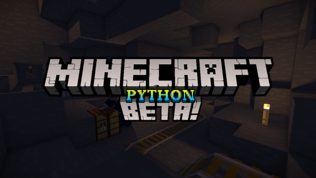

Minecraft Python is a Python recreation of the `beta` Minecraft experience. As time goes on, I'll gradually iterate through newer and newer minecraft versions. I don't have an end goal for this.

> **Disclaimer & Legal Notice:** This project is an unofficial, non-commercial fan recreation built entirely for educational and recreational purposes. It is **NOT** a 1:1 port of Minecraft Java Edition and has its own suite of bugs, imperfections, and differences from the original game.
>
> *Minecraft is a trademark of Mojang Synergies AB / Microsoft Corporation. This project is not affiliated with, endorsed by, or associated with Mojang or Microsoft.*

## Features

- Java-accurate (90% sure) worlds with chunk loading and world saving.
- Exploration, block breaking and placement, and an inventory with crafting.
- Survival gameplay, including health, damage, respawning, and hostile and passive creatures.
- Gameplay systems including fluids, furnaces, chests, signs, doors, redstone, and minecarts.
- Day and night cycles, particles, music, and sounds.
- Experimental proprietary multiplayer with a dedicated server module.
- Save format compatibility (also 90% sure) between Java and Python.
- Mod and texture pack support, including six built-in mods.
- The Nether dimension (singleplayer for now).

## Documentation

- [Getting started](docs/getting-started.md): requirements and launching the game.
- [Gameplay and saves](docs/gameplay.md): default controls, settings, and save locations.
- [Dedicated server](docs/dedicated-server.md): hosting worlds and server commands.
- [Mods](docs/mods.md): built-in mods, external Python mods, and per-mod language files.
- [Contributing](CONTRIBUTING.md): Contributions!

### Happy Minecrafting!
